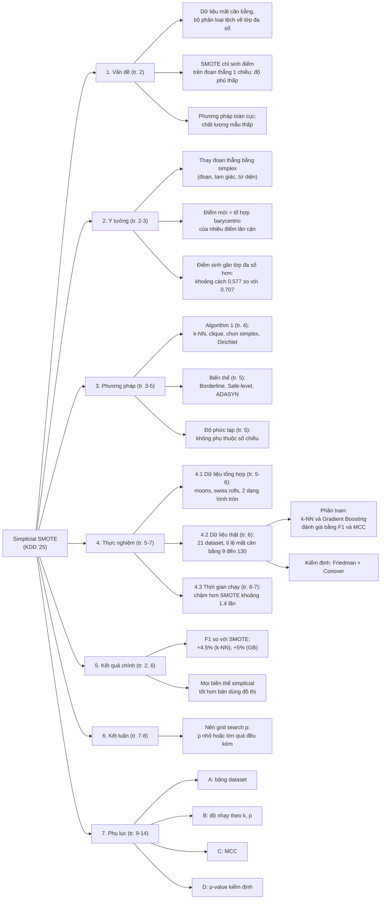

# Sơ đồ tư duy: Simplicial SMOTE

Nguồn: [Simplicial SMOTE (arXiv:2503.03418)](../papers/2503.03418v1.pdf). Số trang trong ngoặc là số trang PDF.

Paper chỉ đề xuất một phương pháp tạo mẫu (sampler), không đề xuất mô hình mới. Phần "train" chỉ dùng để đo hiệu quả: k-NN và Gradient Boosting được train trên dữ liệu đã tăng cường, rồi so sánh F1 và MCC.

## Ba đóng góp của paper ([trang 2](../papers/2503.03418v1.pdf#page=2))

1. Đề xuất cách tạo mẫu Simplicial SMOTE.
2. Chứng minh phương pháp này cải thiện hiệu năng cho nhiều bộ phân loại.
3. Tổng quát hóa Borderline, Safe-level và ADASYN theo cách lấy mẫu trên simplex.

## Phần train và đánh giá ([trang 6](../papers/2503.03418v1.pdf#page=6))

- Bộ phân loại: k-NN với tham số mặc định, Gradient Boosting với độ sâu cây tối đa là 2.
- Đánh giá: F1 và MCC, trung bình trên 5 lần lặp của 5-fold cross-validation.
- Kiểm định thống kê: Friedman test với Conover post-hoc.

Ghi chú: sơ đồ này là tóm tắt của mình, không phải nội dung trực tiếp của paper. Các ý được gắn số trang để tiện kiểm tra lại.
