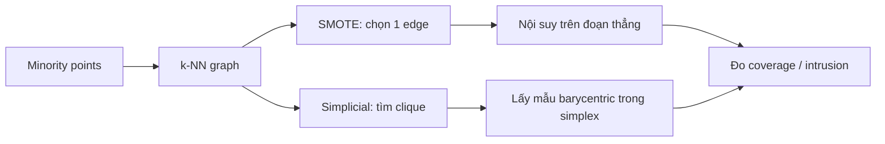

# Báo cáo nghiên cứu: Ý tưởng demo để so sánh Simplicial SMOTE với các phương pháp oversampling cũ — không cần huấn luyện mô hình

## Tóm tắt điều hành

Bài báo bạn cung cấp là **“Simplicial SMOTE: Oversampling Solution to the Imbalanced Learning Problem”**, KDD 2025, của Oleg Kachan, Andrey Savchenko và Gleb Gusev. Ý tưởng trung tâm là thay mô hình hình học “đồ thị cạnh” của SMOTE bằng **simplicial complex**: SMOTE truyền thống sinh điểm trên đoạn thẳng nối hai mẫu thiểu số, trong khi Simplicial SMOTE lấy tổ hợp barycentric của nhiều điểm gần nhau và do đó có thể lấy mẫu từ tam giác, tứ diện hoặc simplex bậc cao. Tác giả lập luận rằng cách này tăng **coverage** của phân bố thiểu số, vẫn tôn trọng cấu trúc cục bộ như cluster và “lỗ” tô-pô, đồng thời có thể sinh điểm gần biên lớp hơn. fileciteturn0file0 citeturn512205view1

Điểm quan trọng đối với yêu cầu “**không train model**” là không nhất thiết phải lặp lại toàn bộ thí nghiệm classifier của paper. Có thể so sánh trực tiếp chất lượng của **phân bố synthetic samples** bằng các metric thuần hình học: coverage của minority manifold, khoảng cách tới minority thật, mức xâm nhập vùng majority, local label purity, tỷ lệ synthetic point rơi vào “hole”, diversity, thời gian sinh mẫu và bộ nhớ. Đây thực chất bám rất sát lập luận lý thuyết của paper hơn là chỉ nhìn F1 của một classifier. Paper cũng định nghĩa vấn đề theo hai khía cạnh đối ngẫu là **sample quality/precision** và **data coverage/recall**, nên hướng demo classifier-free này có cơ sở trực tiếp từ chính công trình. fileciteturn0file0

Sau khi cân đối độ trực quan, khả năng tái lập, dataset công khai và mức độ “thấy ngay” sự khác biệt, tôi khuyến nghị ưu tiên ba demo đầu tiên: **Topology Stress Test**, **Optical Digits — rare digit 8**, và **Oil Spill**. Nếu cần một demo duy nhất để trình bày trước lớp hoặc hội đồng, Topology Stress Test dễ hiểu nhất; nếu muốn gây ấn tượng thị giác, Optical Digits tốt nhất; nếu muốn bám sát kết quả thực nghiệm nổi bật của paper, Oil Spill mạnh nhất. Paper báo cáo Simplicial SMOTE tốt hơn SMOTE trung bình khoảng 4,5% F1 với k-NN và 5% với gradient boosting trên benchmark của họ, với mức tăng cá biệt lớn hơn nhiều; đồng thời runtime oversampling trong thí nghiệm của paper khoảng **1,4× SMOTE**, tạo một câu chuyện trade-off rất rõ: thêm một chút chi phí tính toán để đổi lấy coverage tốt hơn. fileciteturn0file0

iturn522747image0turn522747image3turn522747image4turn522747image7

Bốn hình tham khảo phía trên cho thấy các cách trực quan rất phù hợp cho demo: decision boundary trước/sau oversampling, cách SMOTE nội suy giữa các điểm, vùng sinh mẫu của các biến thể geometric SMOTE, và scatter 3D so sánh nhiều sampler. Hình thứ hai còn đến từ một nguồn tiếng Việt, hữu ích để lấy cảm hứng trình bày cho khán giả Việt Nam; tuy nhiên nguồn chính để kiểm chứng thuật toán vẫn nên là paper, UCI và tài liệu chính thức của `imbalanced-learn`. citeturn522747image0turn522747image3turn522747image4turn522747image7

## Cơ sở so sánh và nguyên tắc thiết kế demo

SMOTE gốc sinh một mẫu mới bằng cách chọn một minority point và một trong các k-nearest minority neighbors rồi nội suy trên đoạn thẳng giữa hai điểm. Đây là phương pháp chuẩn từ Chawla et al. năm 2002. Borderline-SMOTE sau đó giới hạn oversampling vào các điểm minority gần decision boundary; Safe-Level-SMOTE điều chỉnh vị trí nội suy theo mức “an toàn” của vùng lân cận; ADASYN phân bổ nhiều synthetic points hơn cho các điểm minority khó phân loại. citeturn808837search0turn808837search7turn808837search9turn808837search8

Simplicial SMOTE thay cạnh của k-NN graph bằng các clique/simplex. Với simplex có các đỉnh \(x_0,\ldots,x_p\), điểm synthetic có dạng \(\hat{x}=\sum_i\lambda_i x_i\), trong đó các \(\lambda_i\) là barycentric coordinates lấy từ Dirichlet distribution. Thuật toán có hai hyperparameter chính: kích thước neighborhood \(k\) và dimension/arity tối đa \(p\). citeturn512205view1

Điều này gợi ý năm metric không cần classifier rất phù hợp: **Coverage@r**, tức tỷ lệ điểm minority thật nằm trong bán kính \(r\) của ít nhất một synthetic point; **Synthetic precision**, tức tỷ lệ synthetic points có hàng xóm gần nhất chủ yếu thuộc minority; **majority intrusion**, tức tỷ lệ synthetic points có majority point gần hơn minority point; **diversity**, đo bằng khoảng cách cặp hoặc số cell không gian được phủ; và **runtime/memory**, đo chi phí xây k-NN graph, tìm clique và sampling. Các metric này đo trực tiếp lời hứa “coverage tốt hơn nhưng không phá topology” của Simplicial SMOTE. citeturn512205view1

Để tái lập nhanh, có thể dùng repository công khai đi kèm paper; repository chứa code, thư mục `ssmote`, dữ liệu, script `experiment.py` và file requirements. README hướng dẫn tạo virtual environment, cài dependencies rồi chạy `python experiment.py`. citeturn512205view0  
**Code paper:** [GitHub — Simplicial SMOTE](https://github.com/av-savchenko/simplical-smote)  
**Paper:** [arXiv 2503.03418](https://arxiv.org/abs/2503.03418)  
**Baseline library:** [imbalanced-learn](https://imbalanced-learn.org/stable/)

## Ma trận lựa chọn demo

`imbalanced-learn` hiện cung cấp trực tiếp 27 benchmark dataset mất cân bằng đã được nhị phân hóa. Trong số đó có Ecoli 8,6:1, Optical Digits 9,1:1, Abalone 9,7:1, Oil 22:1, Wine Quality 26:1, Ozone 34:1 và Abalone-19 tới 130:1. Điều này rất thuận lợi vì không phải tự tái tạo label mapping của paper. citeturn512205view2

| Demo | Dataset công khai | Train predictive model? | Tiềm năng trực quan | Thời gian ước tính | Điểm mạnh kỳ vọng |
|---|---|---:|---|---:|---|
| Topology Stress Test | sklearn/paper synthetic generators | Không | ★★★★★ | 3–5 giờ | Chứng minh trực tiếp “edge vs simplex”, hole avoidance và coverage |
| Rare handwritten digit 8 | UCI Optical Digits | Không | ★★★★★ | 4–6 giờ | Có thể hiển thị synthetic point thành ảnh 8×8 |
| Oil-spill minority coverage | imbalanced-learn benchmark | Không | ★★★★☆ | 4–6 giờ | Bám sát dataset nơi paper báo cáo gain lớn |
| Ecoli rare localization | UCI Ecoli | Không | ★★★★☆ | 3–5 giờ | Dataset nhỏ, rất nhanh, dễ vẽ geometry |
| Extreme imbalance Abalone-19 | UCI Abalone | Không | ★★★★☆ | 3–5 giờ | Stress test IR ≈130:1 |
| Rare low-quality wine | UCI Wine Quality | Không | ★★★★★ | 4–6 giờ | Feature có nghĩa vật lý, dễ đánh giá plausibility |
| Ozone quality–latency frontier | UCI Ozone Level Detection | Không | ★★★★☆ | 5–8 giờ | 72 chiều, thể hiện rõ trade-off coverage–runtime |

Thời gian trên là ước tính triển khai một notebook hoàn chỉnh trên laptop hiện đại, không bao gồm thời gian làm slide/video. Không demo nào yêu cầu huấn luyện classifier; phép chuẩn hóa, k-NN search hoặc PCA để trực quan hóa không phải là huấn luyện predictive model.

## Các demo cụ thể

### Topology Stress Test: simplex lấp manifold nhưng không lấp “lỗ”

**Bài toán.** Tạo minority distribution có topology phức tạp — moons, vòng tròn đồng tâm, Swiss-roll projection hoặc Gaussian-inside-circle — rồi yêu cầu mỗi sampler sinh đủ điểm để cân bằng lớp. Đây chính là loại synthetic data mà paper sử dụng để minh họa tại Figure 3; các tập synthetic trong paper có 350 điểm, trong đó 50 minority và 300 majority. fileciteturn0file0

**Dataset.** Không cần tải dữ liệu tĩnh; dùng generator công khai của scikit-learn và script trong repository của paper. [Repository paper](https://github.com/av-savchenko/simplical-smote) chứa code và dữ liệu đi kèm. Paper cho biết synthetic benchmark được tạo một phần bằng scikit-learn. fileciteturn0file0

**Baseline.** Random Oversampling, SMOTE, global convex-pair sampling và Gaussian sampling. Đây chính là nhóm baseline hình học mà paper dùng để minh họa sự khác biệt giữa duplication, edge interpolation, global convex hull và simplex sampling. citeturn512205view1

**Metric.** Tốt nhất là `hole intrusion rate`, `coverage@r`, `minority-neighbour purity`, Hausdorff distance giữa real-minority và augmented-minority, mean nearest-real-minority distance, cùng runtime. Với circles/moons, có thể định nghĩa “ground-truth support mask” nên precision/recall của synthetic distribution gần như trực tiếp, không cần classifier.

**Workflow.** Sinh cùng một bộ dữ liệu và cố định random seed; chuẩn hóa; chạy Random, SMOTE và Simplicial SMOTE với cùng số synthetic samples; sweep \(k=3,5,7\) và \(p=2,3,\ldots,k\); tính coverage và intrusion; cuối cùng animate các điểm synthetic xuất hiện lần lượt. Paper mô tả Simplicial SMOTE dùng clique complex của symmetric k-NN graph và sample barycentric coordinates trong simplex. citeturn512205view1

**Visual.** Bố cục bốn panel rất hiệu quả: “real only”, “SMOTE edges”, “global convex hull”, “Simplicial triangles”. Tô vùng hole bằng xám và đặt counter `points inside hole`. Một slider \(p\) cho thấy khi tăng simplex dimension, vùng được phủ thay đổi thế nào.

**Tài nguyên.** Python, NumPy, scikit-learn, NetworkX hoặc implementation trong repo; CPU bất kỳ, RAM <2 GB. **Thời gian:** 3–5 giờ.

### Rare handwritten digit 8: “synthetic sample nhìn có giống số 8 thật không?”

**Bài toán.** Biến digit **8** thành minority class và các digit còn lại thành majority. Benchmark `imbalanced-learn` dùng đúng target 8 với imbalance ratio khoảng 9,1:1. UCI Optical Recognition of Handwritten Digits có 5.620 mẫu, 64 feature; mỗi vector 64 chiều tương ứng một bitmap 8×8 với giá trị pixel 0–16. citeturn512205view2turn752053search5

**Dataset/download.** [UCI Optical Recognition of Handwritten Digits](https://archive.ics.uci.edu/dataset/80/optical+recognition+of+handwritten+digits). Đây là nguồn chính thức UCI. citeturn752053search5

**Baseline.** Random Oversampling, SMOTE và ADASYN; có thể thêm Borderline-SMOTE. SMOTE và ADASYN đều có implementation chuẩn trong `imbalanced-learn`. citeturn925757search4turn925757search3

**Metric.** Không cần OCR classifier. Với mỗi synthetic “8”, đo khoảng cách tới nearest real-8; tỷ lệ k-nearest real samples thuộc digit 8; pixel total-variation — proxy cho độ mượt/nhòe; diversity của synthetic images; coverage của real-8 set; và duplicate rate. Có thể thêm SSIM với nearest real 8 như một metric thị giác, nhưng nên xem nó là metric bổ sung chứ không phải ground truth.

**Workflow.** Lấy dữ liệu 64 chiều; label `8` là minority; sinh cùng số mẫu với mỗi method; reshape synthetic vector thành 8×8; xếp grid 10×10; tính purity và coverage; cho người xem click vào một synthetic image để hiện các “parent points”: với SMOTE là hai ảnh, với Simplicial SMOTE là 3–4 ảnh tạo simplex.

**Visual.** Đây là demo có khả năng “wow” cao nhất: hàng trên là real 8, hàng giữa là SMOTE synthetic, hàng dưới là Simplicial synthetic. Khi hover lên ảnh, hiển thị simplex polygon trong một projection 2D và các trọng số barycentric \(\lambda_i\).

**Tài nguyên.** CPU laptop, NumPy/scikit-learn/matplotlib, repo paper; <1 GB RAM. **Thời gian:** 4–6 giờ. Dataset nhỏ và các pixel đã được giảm từ bitmap 32×32 xuống 64 feature nên thao tác rất nhẹ. citeturn752053search5

### Oil Spill: coverage ở vùng minority cực hiếm

**Bài toán.** Tập `oil` trong benchmark có 937 mẫu, 49 feature và imbalance ratio khoảng 22:1. Đây là dataset đặc biệt đáng chọn vì trong paper, Oil là trường hợp Simplicial SMOTE cho mức cải thiện F1 rất lớn so với SMOTE với gradient boosting; vì demo của bạn không train classifier, ta dùng nó như motivation rồi kiểm tra xem improvement có đi kèm cải thiện hình học hay không. citeturn512205view2 fileciteturn0file0

**Dataset/download.** Cách tái lập đáng tin cậy nhất là dùng [`imblearn.datasets.fetch_datasets`](https://imbalanced-learn.org/stable/datasets/index.html), trong đó `oil` đã được chuẩn hóa thành benchmark binary giống họ dữ liệu được paper dùng. citeturn512205view2

**Baseline.** Random Oversampling, SMOTE, Borderline-SMOTE, ADASYN; nếu muốn gần paper hơn, thêm Safe-Level-SMOTE. Borderline-SMOTE tập trung vào điểm gần biên, còn ADASYN ưu tiên minority examples khó. citeturn808837search7turn808837search8

**Metric.** `majority intrusion rate` là metric chính: với mỗi synthetic point, lấy 7 nearest original points và tính tỷ lệ majority. Thêm `minority coverage@r`, distribution của khoảng cách synthetic→majority, distribution synthetic→minority và generation time. Một metric rất dễ giải thích là “% synthetic samples có ≥4/7 nearest originals là minority”.

**Workflow.** Fetch dataset; standardize trên original data; chạy 4 sampler với cùng target size; tính neighbor statistics hoàn toàn trên original points để tránh self-bias; bootstrap 20 seeds; vẽ violin plot cho local purity và coverage; cuối cùng cho phép click vào một synthetic point để xem 7 neighbors gốc quanh nó.

**Visual.** Dùng random projection cố định xuống 2D thay vì UMAP nếu muốn tuyệt đối tránh việc “fit” một embedding model. Overlay minority thật bằng vòng tròn, majority bằng chấm nhỏ, synthetic bằng tam giác. Một side panel hiển thị local neighborhood của điểm đang hover.

**Tài nguyên.** CPU, scikit-learn, imbalanced-learn, NetworkX; RAM <2 GB. **Thời gian:** 4–6 giờ.

### Ecoli: minority manifold nhỏ nhưng rõ ràng

**Bài toán.** Ecoli có 336 mẫu, 7 feature liên tục và nhiều class protein localization. Benchmark mất cân bằng chọn class `imU` làm positive, tạo tỷ lệ khoảng 8,6:1; tài liệu `imbalanced-learn` cho biết bản benchmark có 301 negative và 35 positive. citeturn512205view2 UCI mô tả các feature như `mcg`, `gvh`, `aac`, `alm1`, `alm2` và xác nhận dataset có 336 instances, 7 feature. citeturn512205view5

**Dataset/download.** [UCI Ecoli](https://archive.ics.uci.edu/dataset/39/ecoli). citeturn512205view5

**Baseline.** SMOTE, Borderline-SMOTE, Safe-Level-SMOTE và ADASYN. Đây cũng là các phương pháp mà paper trực tiếp đặt Simplicial SMOTE và các simplicial extension cạnh nhau. fileciteturn0file0

**Metric.** Coverage của 35 mẫu `imU`, local class purity, minimum distance đến majority, synthetic diversity, số connected component của minority k-NN graph sau augmentation, và runtime. Với chỉ 7 feature, metric Euclidean sau standardization khá dễ giải thích.

**Workflow.** Chuyển Ecoli thành binary `imU vs rest`; standardize; cố định \(k=5\); sinh đủ synthetic để cân bằng; tính coverage curve khi tăng synthetic budget từ 25%, 50%, 75% tới 100%; chạy Simplicial với \(p=2,3,4\); vẽ “coverage per 100 generated points”.

**Visual.** Matrix 7×7 scatter cho các feature quan trọng hoặc 2D PCA chỉ dùng cho hình vẽ. Một hình đặc biệt hiệu quả là “edge vs filled triangle”: chọn ba minority points gần nhau, tô cạnh mà SMOTE có thể sample và diện tích bên trong mà Simplicial có thể sample.

**Tài nguyên.** CPU bất kỳ; Python/scikit-learn/imbalanced-learn. **Thời gian:** 3–5 giờ.

### Abalone-19: stress test mất cân bằng 130:1

**Bài toán.** Đây là demo tốt nhất để kiểm tra extreme imbalance. `imbalanced-learn` định nghĩa `abalone_19` với target ring 19 và imbalance ratio khoảng **130:1**, dùng 4.177 observations và 10 feature sau preprocessing. citeturn512205view2 Dataset UCI gốc có 4.177 mẫu, tám feature vật lý như chiều dài, đường kính, khối lượng vỏ, khối lượng thịt và biến target `Rings`. citeturn752053search1

**Dataset/download.** [UCI Abalone](https://archive.ics.uci.edu/dataset/1/abalone); hoặc lấy bản binary chính xác bằng [`fetch_datasets()['abalone_19']`](https://imbalanced-learn.org/stable/datasets/index.html). citeturn752053search1turn512205view2

**Baseline.** Random Oversampling là baseline đặc biệt quan trọng ở đây vì nó chỉ duplicate minority examples; SMOTE thêm diversity dọc theo edges; Simplicial SMOTE có thể điền thể tích local simplex. So sánh ba mức này rất trực quan. Cách phân loại geometric sampler theo neighborhood/model dimension cũng chính là framing Figure 1 của paper. citeturn512205view1

**Metric.** Unique synthetic ratio; effective sample size; coverage@r; median distance từ mỗi real minority point đến synthetic nearest neighbor; local density variance; peak memory và milliseconds/1.000 synthetic samples.

**Workflow.** Lấy minority `Rings=19`; tạo các synthetic budgets 1×, 5×, 20× và tới mức balance hoàn toàn; với mỗi budget đo coverage; chạy 30 seeds để có confidence interval; so sánh đường `coverage vs synthetic budget`.

**Visual.** Một animation cực rõ: Random Oversampling tạo các điểm chồng lên nhau; SMOTE mở rộng thành các “sợi dây”; Simplicial phủ thành các vùng. Vẽ thêm “coverage saturation curve”; một phương pháp tốt sẽ đạt coverage cao với ít synthetic samples hơn.

**Tài nguyên.** Laptop CPU, RAM <2 GB. **Thời gian:** 3–5 giờ.

### Wine Quality: synthetic sample có còn “hợp lý về mặt vật lý” không?

**Bài toán.** UCI Wine Quality có 4.898 mẫu với 11 chỉ số hóa-lý như acidity, residual sugar, chlorides, density, pH, sulphates và alcohol. Dataset có class quality không cân bằng; benchmark `imbalanced-learn` chọn `quality <= 4` làm minority, tạo tỷ lệ khoảng 26:1. citeturn326946search3turn512205view2

**Dataset/download.** [UCI Wine Quality](https://archive.ics.uci.edu/dataset/186/wine+quality). UCI cung cấp CSV cho red và white wine. citeturn326946search3

**Baseline.** Random, SMOTE, global convex-pair sampling và Gaussian-fit sampling. Global/Gaussian rất có ích trong demo này vì paper lập luận rằng phương pháp global có thể phá local geometry và tạo sample chất lượng thấp, trong khi Simplicial giữ tính cục bộ. citeturn512205view1

**Metric.** Ngoài coverage/purity, thêm **physical plausibility score**: với từng feature, điểm synthetic có nằm trong khoảng min–max của local minority neighborhood hay không; local Mahalanobis distance; số feature vượt percentile 0,5–99,5 của minority; sai lệch correlation matrix giữa synthetic và real minority.

**Workflow.** Lấy white-wine dataset, minority=`quality<=4`; chạy samplers; với mỗi synthetic sample tìm 10 minority neighbors gốc; kiểm tra feature-wise envelope; tổng hợp thành `plausibility violation rate`; so sánh với coverage để cho thấy một sampler có thể đạt coverage cao nhưng lại làm giảm plausibility.

**Visual.** Parallel-coordinates plot rất phù hợp vì feature có tên dễ hiểu. Người xem click vào synthetic sample và thấy đường của nó cạnh 10 wine thật gần nhất. Thêm radar chart của median absolute deviation theo từng feature.

**Tài nguyên.** CPU laptop, pandas, NumPy, scikit-learn. **Thời gian:** 4–6 giờ.

### Ozone: đường biên giữa chất lượng và chi phí tính toán

**Bài toán.** UCI Ozone Level Detection có 2.536 records, 72 feature khí tượng và được thu thập giai đoạn 1998–2004 ở khu Houston–Galveston–Brazoria. Benchmark `imbalanced-learn` có imbalance ratio khoảng 34:1. citeturn752053search0turn512205view2

**Dataset/download.** [UCI Ozone Level Detection](https://archive.ics.uci.edu/dataset/172/ozone+level+detection); UCI cung cấp `onehr.data`, `eighthr.data` và metadata files. citeturn752053search3

**Baseline.** SMOTE là baseline chính; thêm Random Oversampling để có lower bound về chi phí và ADASYN để có adaptive baseline. SMOTE chỉ cần neighbor graph và interpolation trên edge, còn Simplicial thêm bước clique finding, nên đây là dataset tốt để trực quan hóa trade-off compute–quality. Paper phân tích rằng clique enumeration là phần chi phí mới của Simplicial SMOTE. citeturn512205view1

**Metric.** X-axis là milliseconds hoặc peak RAM; Y-axis là coverage; bubble size là majority intrusion rate. Sweep \(k=3,5,7,10\) và \(p=2,3,4\). Kết quả sẽ cho một **Pareto frontier**: không chỉ hỏi “cái nào tốt hơn”, mà hỏi “đổi thêm bao nhiêu latency để lấy thêm bao nhiêu coverage”.

Paper báo cáo trong benchmark của họ SMOTE với \(k=10\) mất khoảng 15,03 giây và Simplicial SMOTE \(k=10,p=3\) khoảng 20,79 giây trên toàn bộ benchmark chạy trên hệ thống Xeon nhiều core, tức Simplicial khoảng 1,4× chậm hơn ở bước oversampling. Đây là con số tham chiếu chứ không phải latency bạn nên kỳ vọng trên laptop. fileciteturn0file0

**Workflow.** Chạy mỗi setting 30 lần với cùng seed list; đo wall-clock bằng `perf_counter`, peak memory bằng `tracemalloc`; tính coverage/purity; vẽ Pareto chart; chọn một điểm “sweet spot”, chẳng hạn \(p=3\), rồi show synthetic geometry.

**Visual.** Đây là demo tốt nhất cho khía cạnh engineering: scatter `runtime ↔ coverage`, label từng phương pháp, thêm slider \(p\). Người xem nhìn thấy ngay Simplicial không “miễn phí”, mà là một trade-off có thể định lượng.

**Tài nguyên.** CPU laptop 8–16 GB RAM là dư; GPU không cần. **Thời gian:** 5–8 giờ.

## Kiến trúc đánh giá chung và cách làm demo thật sự công bằng

Để so sánh đúng, tất cả sampler phải nhận **cùng tập dữ liệu gốc, cùng split, cùng random seeds và cùng số synthetic samples**. Không nên dùng một classifier downstream để chọn \(k,p\), vì như vậy vô tình quay lại bài toán training. Thay vào đó, hãy định nghĩa một grid nhỏ trước, chẳng hạn \(k∈\{3,5,7\}\), \(p∈\{2,3,4\}\), rồi báo cáo toàn bộ quality–coverage–runtime frontier. Paper cũng sử dụng \(k\) làm neighborhood-size hyperparameter và \(p\) làm maximal simplex dimension. citeturn512205view1

Một protocol phù hợp là chia original data theo stratified 80/20 nhưng **không train gì cả**: sampler chỉ được nhìn 80%; 20% minority points đóng vai trò “unseen real minority samples”. Sau khi oversampling 80%, đo khoảng cách và coverage trên 20% minority holdout. Cách này mạnh hơn việc đo coverage trên chính các điểm đã dùng để tạo synthetic samples, vì giảm nguy cơ một sampler được lợi chỉ vì nằm sát các điểm cha. Đây là đề xuất thiết kế thực nghiệm của báo cáo này, không phải protocol trong paper.

Có thể định nghĩa `holdout coverage@r` như:

\[
C(r)=\frac{1}{|H_+|}\sum_{x\in H_+}\mathbf{1}
\left[\min_{\hat x\in S} d(x,\hat x)\le r\right],
\]

trong đó \(H_+\) là minority holdout và \(S\) là synthetic set. Song song, `intrusion@k` có thể là tỷ lệ synthetic points mà đa số trong \(k\) nearest **original** neighbors thuộc majority. Hai trục này gần với chính khái niệm “coverage vs sample quality” mà paper nhấn mạnh. citeturn512205view1

Về phần mềm, `imbalanced-learn` hiện có sẵn SMOTE, ADASYN, BorderlineSMOTE và các dataset benchmark, nên phần baseline gần như không cần code mới. citeturn925757search3turn512205view2 Simplicial SMOTE lấy từ repository của tác giả. citeturn512205view0 Điều này giúp demo có tính tái lập cao hơn đáng kể so với việc tự viết lại mọi thuật toán.

Một dashboard tốt nên có ba pane: bên trái là dữ liệu real + synthetic, giữa là histogram `local minority purity`, bên phải là gauge `coverage / intrusion / runtime`. Với dữ liệu >2 chiều, nên giữ một random projection matrix cố định cho mọi sampler; như vậy hình chiếu không phụ thuộc từng phương pháp và tránh hiểu nhầm rằng embedding đang “ưu ái” một sampler.

## Khuyến nghị chọn demo theo mục tiêu trình bày

Nếu mục tiêu là **giải thích ý tưởng paper trong 5–10 phút**, chọn **Topology Stress Test**: nó trực tiếp biến câu “SMOTE lấy mẫu trên cạnh, Simplicial lấy mẫu trong simplex” thành hình ảnh. Figure 1 của paper cũng xây dựng chính câu chuyện này: random oversampling duplicate điểm, global sampling có thể cắt qua lỗ/topology, SMOTE có locality nhưng chỉ phủ các đoạn một chiều, còn Simplicial dùng higher-dimensional simplex để tăng coverage. fileciteturn0file0

Nếu mục tiêu là **demo bắt mắt**, chọn **Optical Digits**. Vì 64 feature có thể reshape thẳng thành ảnh 8×8, người xem không cần hiểu PCA hay latent space vẫn có thể đánh giá synthetic digit bằng mắt; UCI xác nhận dữ liệu được tạo bằng cách chia bitmap 32×32 thành các block 4×4, tạo ma trận 8×8 với giá trị 0–16. citeturn752053search5

Nếu mục tiêu là **bám sát claim thực nghiệm của paper**, chọn **Oil**. Nếu mục tiêu là **stress-test extreme imbalance**, chọn **Abalone-19**. Nếu mục tiêu là **giải thích quality vs compute**, chọn **Ozone**. Nếu muốn một demo mang màu sắc khoa học dữ liệu ứng dụng và dễ kể chuyện cho người không chuyên, **Wine Quality** là lựa chọn rất tốt vì feature có ý nghĩa vật lý rõ ràng. Các dataset này đều có nguồn tải công khai từ UCI hoặc benchmark chính thức của `imbalanced-learn`. citeturn512205view2turn752053search1turn752053search0turn326946search3

Một bộ demo cân bằng cho project khoảng một tuần là **Topology + Optical Digits + Oil**. Bạn chỉ cần xây một framework metric chung một lần; mỗi dataset sau đó chỉ thay loader và visualization. Không cần GPU, không cần fine-tuning hay model training, và phần lớn thời gian nằm ở thiết kế UI/plot chứ không phải compute.

## Nguồn chính và khả năng tái lập

Nguồn ưu tiên nên là paper KDD/arXiv, repository của tác giả, UCI và `imbalanced-learn`. KDD 2025 chính thức liệt kê “Simplicial SMOTE: Oversampling Solution to the Imbalanced Learning Problem” trong Research Track, còn repository công khai chứa code thực nghiệm. citeturn925757search0turn512205view0 Các baseline kinh điển có nguồn gốc rõ ràng: SMOTE — Chawla et al. 2002; Borderline-SMOTE — Han et al. 2005; ADASYN — He et al. 2008; Safe-Level-SMOTE — Bunkhumpornpat et al. 2009. citeturn808837search1turn808837search7turn808837search8turn808837search9

Các đường dẫn thực hành quan trọng nhất là: [code Simplicial SMOTE](https://github.com/av-savchenko/simplical-smote), [imbalanced-learn benchmark datasets](https://imbalanced-learn.org/stable/datasets/index.html), [UCI Optical Digits](https://archive.ics.uci.edu/dataset/80/optical+recognition+of+handwritten+digits), [UCI Ecoli](https://archive.ics.uci.edu/dataset/39/ecoli), [UCI Abalone](https://archive.ics.uci.edu/dataset/1/abalone), [UCI Wine Quality](https://archive.ics.uci.edu/dataset/186/wine+quality), và [UCI Ozone Level Detection](https://archive.ics.uci.edu/dataset/172/ozone+level+detection). UCI là nguồn chính thức cho các dataset tương ứng, còn `fetch_datasets` đặc biệt hữu ích khi muốn khớp chính xác bản binary/imbalanced benchmark. citeturn512205view2turn752053search5turn512205view5turn752053search1turn326946search3turn752053search3